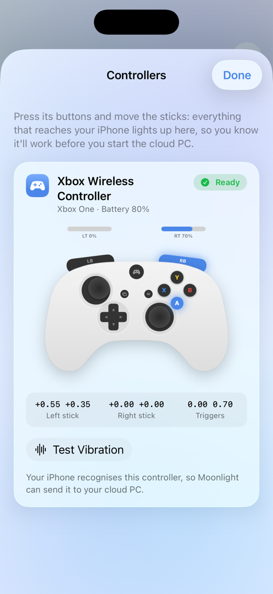
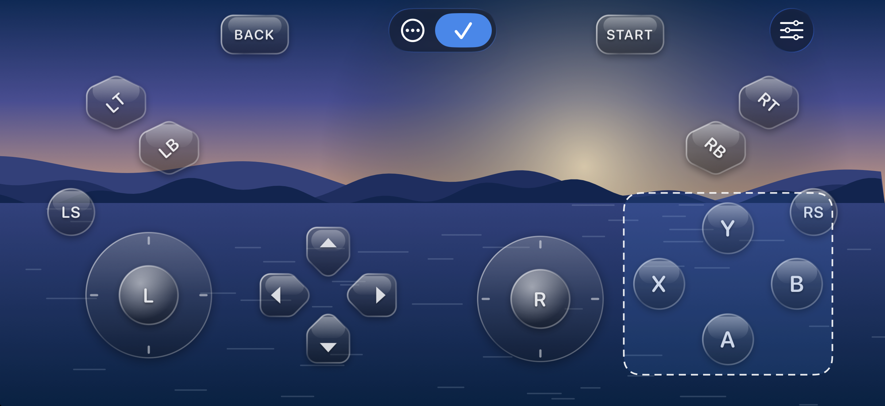
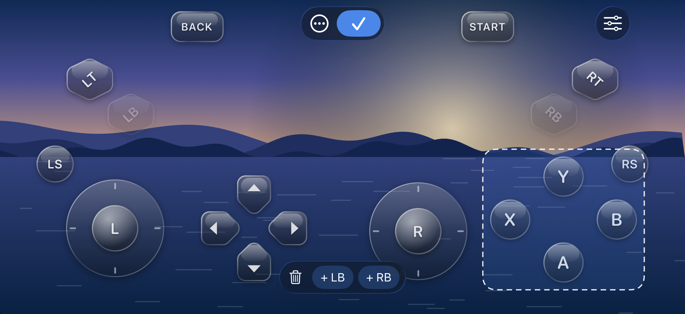
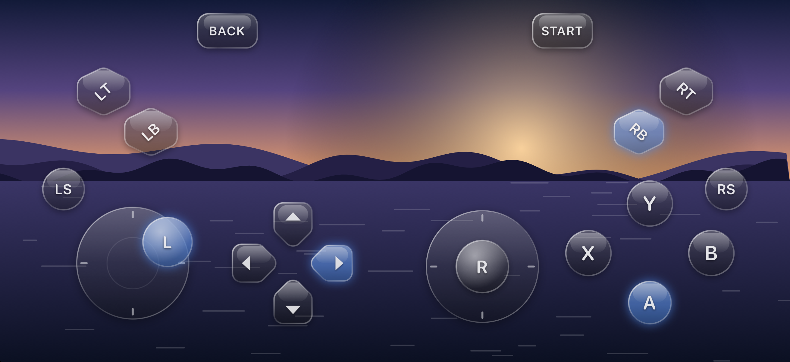
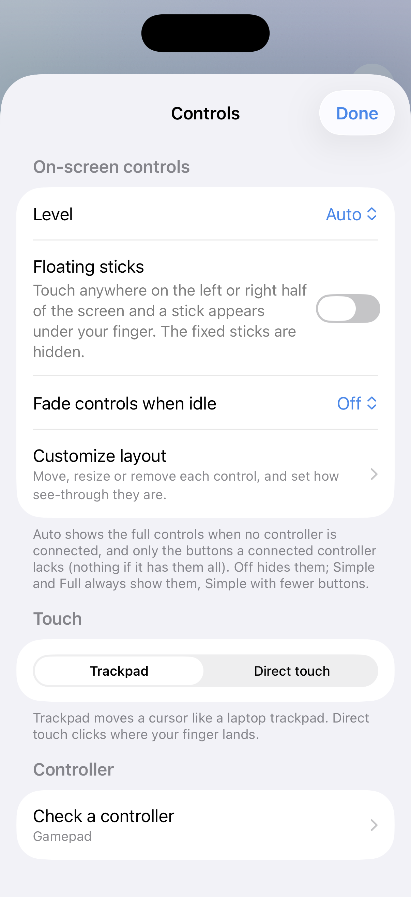

<div align="center">


# AntCloud for iPhone

**Your AntCloud gaming PC on your iPhone. Start it, tap Play, and you're in.**<br>
AntCloud built into the open-source Moonlight client: one app, automatic pairing, no addresses or PINs to type.

<p>
  
  
  
  
  
  
  
</p>

<p><a href="#install-with-sidestore-no-xcode-needed"><b>Install</b></a> &nbsp;·&nbsp; <a href="#what-it-does">What it does</a> &nbsp;·&nbsp; <a href="#build-and-install">Build and install</a> &nbsp;·&nbsp; <a href="#renewing-every-7-days">Renewing every 7 days</a> &nbsp;·&nbsp; <a href="#how-it-works">How it works</a></p>

<p>
  <a href="https://discord.gg/GVDYtpWHps"></a><br>
  <b>Need help, found a bug, or have an idea?</b> Join the community: get help, report bugs and suggest features for AntCloud.
</p>

</div>

> [!IMPORTANT]
> **Unofficial project.** This is an independent client built by a user. It is not made, endorsed or supported by AntCloud.
> "AntCloud" and the AntCloud logo belong to their owners. Use it with your own AntCloud account, and follow AntCloud's terms of service.

## What it does

The app is called **AntCloud** on your home screen and opens straight into it, in portrait. Moonlight only
does the streaming underneath; you never see its host list or settings.

- **Sign in** with email and password or a phone code. Tokens are kept in the iOS Keychain.
- **Your plan up top:** time left this month, the renewal date and a readable plan name, like "Premium Night".
- **Start Cloud PC, then Play.** A drawn monitor and a Connect → Boot → Ready → Stream track show where the session is.
  Play adds the cloud PC to Moonlight, pairs it (the PIN goes to AntCloud's backend for you) and launches Desktop in landscape.
- **Back to AntCloud** as soon as the stream ends.
- **Stream settings in the app:** resolution up to 4K, 30/60/120 FPS, bitrate with data use per hour, HEVC,
  stats overlay and where the sound plays. They're saved straight into Moonlight.
- **A Controls screen of its own:** on-screen controls (Off, Auto, Simple, Full), trackpad or direct touch, floating sticks,
  fade when idle, the layout editor and the controller check, all in one place.
- **Network check** before you start: latency to AntCloud's servers, jitter, packet loss and download speed,
  with a verdict and a one-tap bitrate suggestion.
- **Controller check** (under Controls): a drawn controller mirrors every press, stick and trigger of your controller live, with its
  type, battery, exact stick values and a vibration test, so you know it'll work before you start the cloud PC.
- **Glass on-screen controls** you can move, resize, remove and fade, with floating sticks that appear under your thumb (below).
- **Night plans checked up front:** outside 12:30–9:30 AM IST the app says so before it boots anything.
- **In-stream overlay:** a small pill at the top of the stream shows time left and latency; tap it for the
  full card. It warns you when the cloud PC's connection gets busy and when plan time runs low.
- **Knows when AntCloud changes things:** a banner appears when AntCloud ships a newer Windows app than this code
  matches, and a clear message replaces bare errors if a route disappears.
- **Liquid Glass on iOS 26+,** with a soft aurora behind it, purposeful motion and haptics. Reduce Motion is respected.
  iOS 17–25 get a frosted-material version of the same design.
- **Expiry reminder:** free Apple ID builds last 7 days; the app shows the exact date and reminds you the day before.

<p align="center">
  <picture><source media="(prefers-color-scheme: dark)" srcset=".github/screenshots/dark-controllers.png"></picture>
  <br><sub>The controller check, from Controls → Check a controller.</sub>
</p>

## Glass on-screen controls, placed where you want them

No controller handy? The on-screen gamepad is drawn as glass, and you decide where each piece goes. The editor keeps out of the
way: a small pill at the top, the controls themselves in the clear, and a faint blue tint while you edit.

<p align="center">
  
</p>

- **Open the editor** from **Controls → Customize layout** before you connect, or from the overlay card while you're streaming.
- **Drag** any control to move it. It snaps to the centre lines of the other controls and the screen, with a guide line.
- **Pinch** a control to resize it (60% to 180%), or use the **sliders button** at the top right for **Size** and **Opacity**.
  What you see is what you get.
- **Remove** a control by dragging it onto the **bin** at the bottom. Removed controls wait in the tray next to it, and a tap puts one back.
- **Overlaps** get a red outline, so you can tell when two controls sit on top of each other.
- **The ⋯ menu** has **Try it** (previews presses without sending anything), night or day scenery, and **Reset layout**.
  Your layout is saved on the phone and used in every stream.

<p align="center">
  
  <br><sub>Removed controls sit in the tray until you put them back.</sub>
</p>

<p align="center">
  
  <br><sub>Pressed controls light up.</sub>
</p>

### Floating sticks and fading controls

<table>
  <tr>
    <td width="30%" valign="top">
      <picture><source media="(prefers-color-scheme: dark)" srcset=".github/screenshots/dark-controls.png"></picture>
    </td>
    <td width="70%" valign="top">
      <p>Both live on the <b>Controls</b> screen, next to everything else about input.</p>
      <ul>
        <li><b>Floating sticks:</b> touch anywhere on the left or right half of the screen and a stick appears under your finger. Both thumbs work at once, and the stick keeps working if your thumb slides outside it. Buttons still win when you touch one. The fixed sticks are hidden while this is on.</li>
        <li><b>Fade when idle:</b> the gamepad fades out after 5, 10 or 20 seconds without a touch, and comes back on the next one. Faded controls still respond.</li>
        <li><b>Auto level:</b> shows the full controls when no controller is connected, and only the buttons a connected controller lacks.</li>
      </ul>
    </td>
  </tr>
</table>

## Install with SideStore (no Xcode needed)

**[Download AntCloud-0.16.5.ipa](https://github.com/Sammy970/AntCloudMoonlight/releases/latest)**: unsigned, so it
contains nothing personal, and you sign it with your own Apple ID.

1. Set up [SideStore](https://sidestore.io) on your iPhone (a one-time setup with a computer; their guide walks you
   through it). [AltStore](https://altstore.io) and [Sideloadly](https://sideloadly.io) work too.
2. Download the IPA on your iPhone, then in SideStore go to **My Apps → +** and pick it.
3. SideStore signs it with your Apple ID and installs it. It re-signs it every 7 days in the background, so it keeps
   working. On a free Apple ID it uses one of your three app slots.

## Build and install

Or build it yourself and install it from your Mac:

You need Xcode, an Apple ID for signing (a free one works), and the
[`xcodeproj`](https://github.com/CocoaPods/Xcodeproj) gem.

```sh
# 1. Clone Moonlight next to this repo and fetch its submodules
git clone https://github.com/moonlight-stream/moonlight-ios
git -C moonlight-ios submodule update --init --recursive

# 2. Add AntCloud to it (safe to re-run: applies the patch, adds the Swift files,
#    SocketIO, the icon, the launch screen and the "AntCloud" name)
gem install --user-install xcodeproj
ruby integrate-moonlight.rb ./moonlight-ios

# 3. Point the install script at your signing details, then build and install
cp scripts/renew.env.example scripts/renew.env   # set TEAM_ID and BUNDLE_ID
scripts/renew-and-install.sh
```

The script finds your iPhone over Wi-Fi or USB, builds, installs and prints when the app expires.
Moonlight is built in the Debug configuration on purpose: the Release build only accepts local network
addresses, and a cloud PC isn't on your network.

## Renewing every 7 days

Apps signed with a free Apple ID stop opening 7 days after their signing profile was made, and a plain
rebuild reuses the old profile, so the date doesn't move. To restart the 7 days:

```sh
scripts/renew-and-install.sh              # new profile, rebuild, install
scripts/renew-and-install.sh --integrate  # same, after pulling changes to this repo
scripts/renew-and-install.sh --skip-renew # rebuild and install, keep the current expiry
```

Keep the iPhone unlocked and on the same Wi-Fi as the Mac. Your sign-in and settings survive a reinstall.
A paid Apple Developer account makes builds last a year instead.

## How it works

```
AntCloud panel ── Start ──▶ Socket.IO session queues and boots the cloud PC
      │
     Play ──▶ cloud PC address ──▶ Moonlight adds the host
                                        │
                     pairing PIN ──▶ AntCloud backend (automatic)
                                        │
                                  Desktop launches ──▶ stream ends ──▶ back to the panel
```

## What's in this repo

| Path | What's there |
|---|---|
| `AntCloudPanel.swift` | Entry points Moonlight calls, the app-wide session store, orientation, launch splash |
| `AntCloudHomeView.swift` | The home screen |
| `StreamSettingsSheet.swift` | In-app stream settings and the Controls screen, saved into Moonlight's settings database |
| `OnScreenControlsGlass.swift`, `OSCEditor.swift`, `OSCLayout.swift`, `OSCGlass.swift` | The glass on-screen gamepad: input, floating sticks, fade, the layout editor, the saved layout and the art |
| `OSCSelfTest.swift` | Input-logic checks for the on-screen gamepad (`ANTCLOUD_PREVIEW=controls:selftest` in a debug build) |
| `AppExpiry.swift` | Reads the signing profile's expiry and schedules the reminder |
| `Shared/` | API client, sign-in, session logic and shared views (same code as the Mac app) |
| `moonlight-objc.patch` | Moonlight changes: launch into AntCloud, auto-connect and pair, return after the stream, orientation, launch screen, name, stretch to fill |
| `integrate-moonlight.rb` | Wires everything into a Moonlight checkout |
| `scripts/renew-and-install.sh` | Renews the signing profile, builds and installs |
| `Assets/`, `AntCloudLogo.png`, `AppIcon-1024.png` | Launch screen colour and logo, sign-in logo, app icon |

## Made by

<table>
  <tr>
    <td width="96" valign="middle"><a href="https://github.com/Sammy970"></a></td>
    <td valign="middle">
      <b>Samyak Jain</b><br>
      <sub>Designed and built AntCloud for iPhone and Mac, from reverse-engineering AntCloud's Windows app to the last animation.</sub><br><br>
      <a href="https://github.com/Sammy970"></a>
      <a href="https://x.com/Sammy_970"></a>
    </td>
  </tr>
</table>

If this helped you play on a Mac or iPhone, a ⭐ on the repo or a hello on X is always welcome.

The same credits live in the app: tap the footer on the home screen, or ⋯ → About.

## Notes

Unofficial client, not affiliated with AntCloud. [Moonlight](https://github.com/moonlight-stream/moonlight-ios)
is GPLv3, and so is this repo (see [LICENSE](LICENSE)), since the iPhone app is Moonlight with these additions.
The source here is the AntCloud additions and a patch, never Moonlight's own source; the IPA is built from both.
`Shared/` is copied from [AntCloudMac](https://github.com/Sammy970/AntCloudMac); keep the two in sync.
